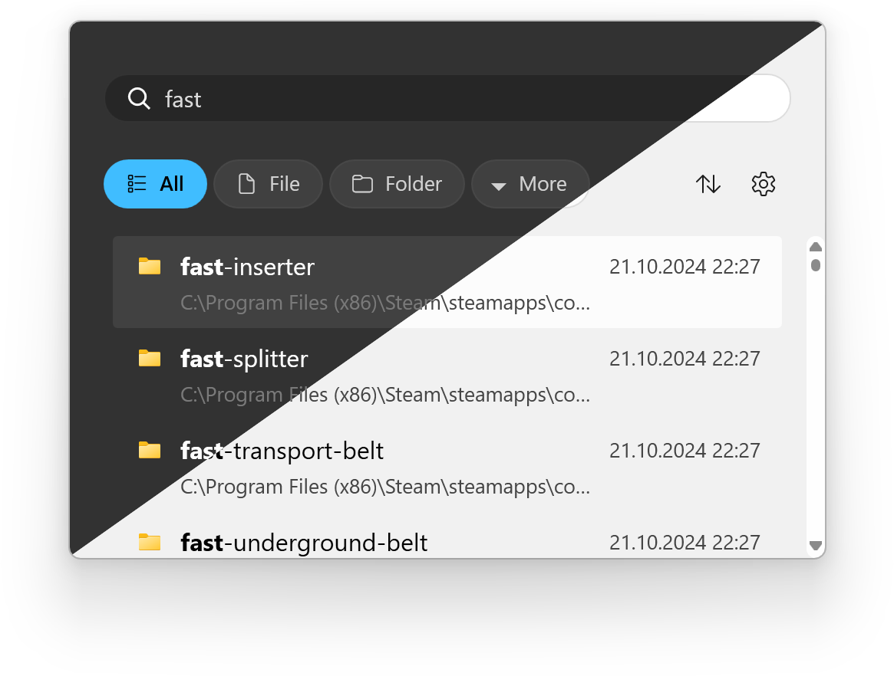
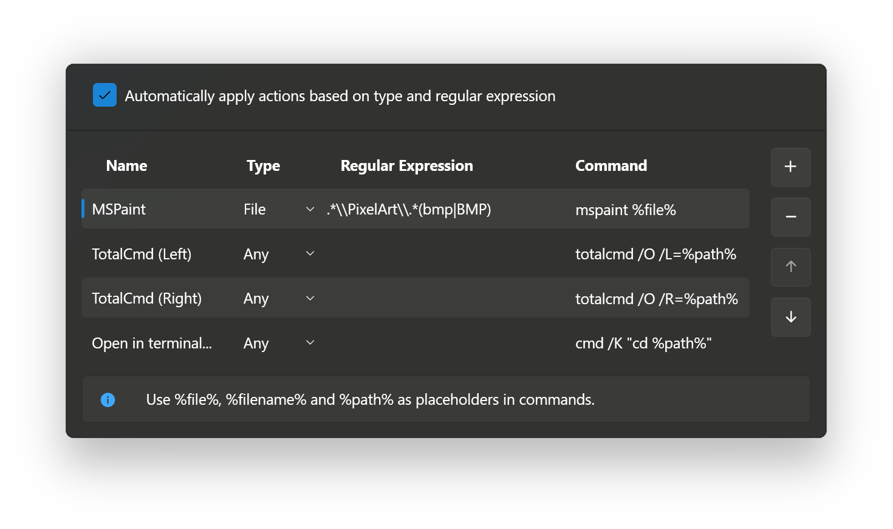

# EverythingToolbar for Fast Windows Taskbar File Search

EverythingToolbar Launcher brings Everything file search to a taskbar search box or icon.
EverythingToolbar uses results from the separately running Everything application developed by voidtools.

The everythingtoolbar deskband offers another integration route for taskbars that support deskbands.
For everyday everythingtoolbar taskbar search, the selected integration changes how you reach the same search interface.
The everythingtoolbar custom filters feature helps turn recurring searches into reusable choices.

[](https://everythingtoolbar-launcher.github.io/EverythingToolbar/)

## Taskbar Integration

Choose an entry point that fits the taskbar you actually use.
On an unmodified Windows 11 taskbar, Launcher can provide a search box or an application icon.
Windows 10 supports the traditional Deskband integration.

The icon opens the search window when selected.
The Windows 11 search box accepts input directly from the taskbar.
Both approaches keep file discovery close to the desktop without turning EverythingToolbar into the Windows Search service.

Deskband support depends on the shell environment.
Windows 11 requires a taskbar modification that restores deskbands for that integration route.
The Launcher search-box mode is intended for the standard Windows 11 taskbar.

The supplied [ToolbarControl.xaml](EverythingToolbar.Deskband/ToolbarControl.xaml) defines the Deskband control layout.
Its companion [ToolbarControl.xaml.cs](EverythingToolbar.Deskband/ToolbarControl.xaml.cs) contains the control's interaction code.
The shared [ISearchWindowController.cs](EverythingToolbar.Core/Services/ISearchWindowController.cs) defines a contract for controlling the search window.



## Quick Search Options

Start with part of a filename, then add constraints that narrow the result set.
A search term, selected filter, and matching flags can all affect what appears.
When a familiar file disappears, examine those controls together.

Everything query syntax provides reusable building blocks:

| Query | Intended result |
|---|---|
| ext:pdf invoice | PDF filenames containing invoice |
| ext:txt;log | Files with either txt or log extensions |
| folder: reports | Folders whose names contain reports |
| ext:docx !draft | Word document filenames excluding draft |

These examples use ordinary Everything query syntax with the global regex option disabled.
Match case, whole-word matching, and path matching provide additional ways to constrain a search.
Regex mode changes how the search text is interpreted.

The supplied [SearchQuery.cs](EverythingToolbar.Core/Search/SearchQuery.cs) records query text, sort choices, and matching flags.
The active search state is represented by [SearchState.cs](EverythingToolbar.App/Search/SearchState.cs).
Result coordination is handled in [SearchSession.cs](EverythingToolbar.App/Search/SearchSession.cs).

For a command-line companion workflow, use the separately available Everything ES utility.
With Everything running and es.exe in the current directory, this PowerShell example copies up to twenty matching paths:

```powershell
$query = "ext:pdf invoice !draft"
$matches = & .\es.exe -n 20 $query
$matches | Set-Clipboard
```

ES belongs to Everything rather than EverythingToolbar.
The same query can be entered in the toolbar to review matching files interactively.
The example updates the clipboard with returned paths; it does not open the files.

The supplied [EverythingItemsProvider.cs](EverythingToolbar.App/Search/EverythingItemsProvider.cs) adapts search results for the application.
The supplied [VirtualizingCollection.cs](EverythingToolbar.App/Search/VirtualizingCollection.cs) supports accessing a result collection in portions.
This helps keep result presentation separate from the complete number of indexed matches.

## Custom Search Filters

A filter should express a category that you expect to use repeatedly.
Document types, media groups, and project-specific filename patterns are useful starting points.
Keep the filter name descriptive enough to understand without opening its definition.

EverythingToolbar provides default filters and can also synchronize filters from Everything.
Enable Use Everything filters in the Filters settings when the Everything definitions should be authoritative.
With synchronization enabled, manage their order in Everything.

Default categories are provided by [DefaultFilterProvider.cs](EverythingToolbar.App/Services/DefaultFilterProvider.cs).
Imported definitions are handled by [EverythingFilterProvider.cs](EverythingToolbar.App/Services/EverythingFilterProvider.cs).
The supplied [FilterProvider.cs](EverythingToolbar.App/Services/FilterProvider.cs) coordinates filter selection.

A filter's data is represented by [Filter.cs](EverythingToolbar.Core/Data/Filter.cs).
Order validation is separated into [FilterOrderValidator.cs](EverythingToolbar.Core/Helpers/FilterOrderValidator.cs).
These files are useful entry points when following how a configured category reaches the interface.

Try a new filter with a file you already know should match.
Then check a similar filename that should be excluded.
This makes a mistaken extension or path condition easier to notice.



## RegEx-Powered File Actions

Finding a file and choosing how to open it are separate decisions.
Custom actions let you associate a command with a result.
An action can remain available in the context menu or participate in automatic rule matching.

The supplied [Rule.cs](EverythingToolbar.App/Data/Rule.cs) contains the rule name, file type, expression, and command.
Persistence and execution are implemented in [CustomActionService.cs](EverythingToolbar.App/Services/CustomActionService.cs).
For automatic matching, the first applicable rule determines the command.

The following XML illustrates a saved rules.xml collection containing a text-file action:

```xml
<ArrayOfRule>
  <Rule>
    <Name>Read text in Notepad</Name>
    <Type>File</Type>
    <Expression>(?i)\.(txt|log)$</Expression>
    <Command>notepad.exe %file%</Command>
  </Rule>
</ArrayOfRule>
```

The expression accepts txt and log extensions without requiring matching letter case.
The file-type condition limits the action to files.
The %file% placeholder is replaced with the selected full path, including quoting supplied by EverythingToolbar.

Use Settings > Custom actions to manage the rule alongside existing actions.
Enable automatic rule application only when that opening behavior is wanted.
Leaving the expression empty keeps an action available for explicit context-menu use.

Other result operations are grouped in [SearchResultActions.cs](EverythingToolbar.App/Search/SearchResultActions.cs).
The platform contract for opening files and running commands is [IFileLauncher.cs](EverythingToolbar.Core/Platform/IFileLauncher.cs).
This separation makes file discovery independent from the program used to open a result.

## Keyboard Shortcuts

A keyboard workflow can move from search to the next file operation without reaching for a menu.
Use the arrow keys to select a result, then choose the appropriate opening action.
The containing-folder action is useful when several related files need attention.

- Enter opens the selected file or folder.
- Ctrl+Enter opens its containing folder.
- Shift+Enter opens the selection in Everything.
- Ctrl+Shift+C copies the full path.
- Alt+Enter displays file properties.
- Tab and Shift+Tab move through filters.

Search history navigation is available when history is enabled.
The supplied [SearchHistory.cs](EverythingToolbar.App/Services/SearchHistory.cs) contains its application-side handling.
Clipboard integration is abstracted by [IClipboard.cs](EverythingToolbar.Core/Platform/IClipboard.cs).

QuickLook or Seer integration can preview a selected file.
Focus matters: Space in the search box inserts a space, while previewing requires focus on a result.
Choose selection behavior that makes this distinction comfortable for your workflow.

## Settings

Matching preferences, filter selection, and interface behavior are configuration choices.
Review them when moving between broad searches and narrowly scoped work.
An unexpectedly restrictive flag can affect every query until it is changed.

The supplied [ToolbarSettings.cs](EverythingToolbar.App/ToolbarSettings.cs) declares persisted toolbar options.
The supplied [ConfigPaths.cs](EverythingToolbar.App/Helpers/ConfigPaths.cs) resolves the application's configuration directory.
Changing the taskbar entry point does not remove the need for the Everything backend.

## Development

The supplied files are a partial collection from the EverythingToolbar project.
They include application services, core contracts, Deskband components, and Everything SDK material.
Some projects visible in the upstream repository are absent from this subset.

The SDK declarations are available in [Everything.h](EverythingSDK/include/Everything.h).
The native implementation is supplied in [Everything.c](EverythingSDK/src/Everything.c).
The application-facing backend contract is [IEverythingClient.cs](EverythingToolbar.Core/Search/IEverythingClient.cs).

When tracing a missing result, distinguish backend retrieval from query state and result display.
When tracing an opening failure, follow the selected result into the file-launching interface.
Application logging is centralized through [ToolbarLogger.cs](EverythingToolbar.App/Helpers/ToolbarLogger.cs).

## FAQ

**Can EverythingToolbar search without Everything running?**

No. Everything supplies the indexed results, and EverythingToolbar presents them.
The Everything Lite edition does not provide the integration needed by the toolbar.

**Does the Launcher replace the native Windows search window?**

It provides its own taskbar entry point and search interface.
It does not merge its results into the native Windows search window.

**Why are there no results for a file that Everything can find?**

Compare the selected filter, matching flags, and configured Everything instance.
A named-instance mismatch or a restrictive query can explain different results.

## Related Search Terms

EverythingToolbar Launcher, EverythingToolbar, everythingtoolbar deskband, everythingtoolbar taskbar search, everythingtoolbar custom filters, everything, everything-search, search-interface, taskbar, windows-taskbar, deskband, toolbar, windows, wpf, productivity
